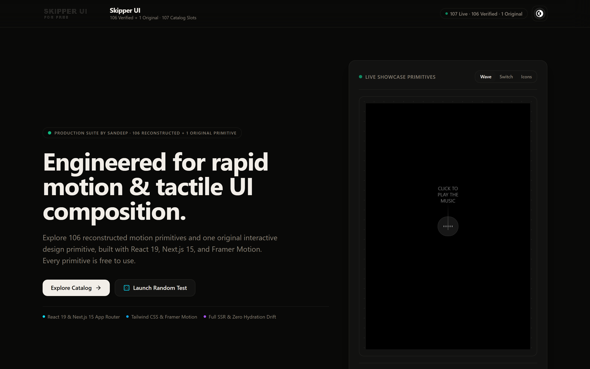
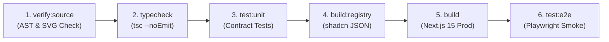

# Skipper UI for Free

<p align="center">
  
</p>

<p align="center">
  <strong>107 Production-Grade Motion Primitives · Clean-Room Reconstructed · 100% Local Assets · Zero CDN Latency</strong>
</p>

<p align="center">
  <a href="https://github.com/Sandeep-Hipparagi/Skipper-UI/actions/workflows/ci.yml"></a>
  <a href="https://nextjs.org/"></a>
  <a href="https://react.dev/"></a>
  <a href="https://www.typescriptlang.org/"></a>
  <a href="https://tailwindcss.com/"></a>
  <a href="https://www.framer.com/motion/"></a>
  <a href="https://gsap.com/"></a>
  <a href="https://threejs.org/"></a>
  <a href="#component-inventory"></a>
  <a href="LICENSE"></a>
</p>

<p align="center">
  🌐 <strong>Live Catalog & Interactive Explorer:</strong> <a href="https://skipper-ui.vercel.app"><strong>skipper-ui.vercel.app</strong></a>
</p>

---

<p align="center">
  <a href="https://skipper-ui.vercel.app">
    
  </a>
</p>

---

## Overview

**Skipper UI for Free** is a comprehensive, production-grade motion component library and interactive gallery reconstructing the complete **Skipper UI** catalog. Built with **Next.js 15**, **React 19**, **Tailwind CSS**, **Framer Motion**, **GSAP**, and **Three.js**, this repository provides **106 clean-room reconstructed motion components** plus an original locally authored interactive design primitive (`skipper93`), all verified with zero runtime regressions.

Every component is architected to be portable, self-contained, fully typed, locally hosted with complete media assets, and instantly extractable into any external React application via shadcn CLI or the bundled component exporter.

---

## Key Features

- **107 Complete Interactive Primitives:** 106 verified upstream reconstructions spanning modern landing page interactions, micro-interactions, Apple-style dynamic islands, 3D WebGL hero scenes, physics-based gesture fields, and fluid carousels.
- **Dedicated Isolated Previews:** Every component has its own dedicated preview route (`/v1/preview/skipper{N}`) rendered without extraneous chrome or dashboard wrappers for clean testing and iframe embeds.
- **Interactive Local Dashboard:** Search, filter by collection/category, switch viewports (**Mobile: 375px**, **Tablet: 768px**, **Desktop: 100%**), inspect props, and view source side-by-side.
- **100% Local Static Media:** Zero external CDN dependencies. All textures, 3D models (`.glb`, `.hdr`), sounds (`.mp3`), and background videos (`.mp4`) are stored locally under `public/`.
- **Zero-Dependency Component Exporter:** Extract any component and its referenced media directly into an external project with a single CLI command.
- **Official shadcn Registry:** Every verified component can be installed into any React or Next.js app with `npx shadcn@latest add`.
- **Strict Quality Assurance:** 100% TypeScript strict adherence (zero `any`), clean memory lifecycle unmount teardown, audio autoplay safeguards, SVG ID collision auditing, and headless Playwright smoke validation.

---

## Quick Start & Local Development

### 1. Prerequisites

- **Node.js:** `22.0.0` or higher
- **Package Manager:** `npm 10+`

### 2. Installation & Running Locally

```bash
# 1. Clone the repository
git clone https://github.com/Sandeep-Hipparagi/Skipper-UI.git
cd Skipper-UI

# 2. Install locked dependencies
npm ci

# 3. Start the development server
npm run dev
```

Open [http://localhost:3000](http://localhost:3000) in your browser:
- Use the **search bar** to search components by title, tag, or tech stack.
- Filter by collections (Navbars, Loaders, Carousels, 3D, Cards, Buttons, Inputs, etc.).
- Click any component card to open the **Interactive Drawer** featuring viewport switching (`375px`, `768px`, `100%`), spec details, and direct links to isolated preview routes.

---

## Component Portability & Extraction

Every component in `src/components/v1/skipper{N}.tsx` is architected to be portable and self-contained. It only relies on:
1. Standard npm packages declared in `package.json`.
2. The shared utility `@/lib/utils` (`cn()` helper).
3. Static media assets predictably located under `public/`.

### Method A: Install via shadcn Registry (Recommended)

Each of the 106 upstream-derived components has a static registry item hosted by the Vercel deployment. You can install any component directly into your shadcn-enabled project:

```bash
# Example: Install component skipper24 into your project
npx shadcn@latest add https://skipper-ui.vercel.app/r/skiper24.json
```

Browse the complete [Registry Index](https://skipper-ui.vercel.app/r/index.json). Registry items reference media hosted on the same origin. 

> *Note: `skipper93` is an original local primitive because the upstream URL returns 404; it is fully available in the local catalog and CLI exporter.*

### Method B: Automated CLI Extraction

We provide an automated extraction utility to copy any component, its internal helpers, and all referenced static assets into a target project:

```bash
# Export skipper24 to an external application directory
npm run export:component skipper24 --dest ../my-new-app

# Or use the one-p alias:
npm run export:component -- skiper24 --dest ../my-new-app
```

The script will:
1. Parse `src/components/v1/skipper24.tsx` for local imports and npm packages.
2. Recursively copy the component and any local helper files to the target directory.
3. Automatically rewrite `@/` path aliases to relative imports.
4. Scan the component for referenced `/public` media (images, audio, 3D models) and mirror them to the destination `public/` folder.
5. Print the exact `npm install` command required for the component's dependencies.

### Method C: Manual Extraction

To manually copy a component:
1. Copy `src/components/v1/skipper{N}.tsx` into your project's components folder.
2. Copy `src/lib/utils.ts` (contains `cn()` using `clsx` and `tailwind-merge`).
3. Check the component's imports for required packages (e.g. `framer-motion`, `lucide-react`, `three`).
4. Copy any referenced static assets from `public/` (e.g. `public/skipperv1/` or `public/audio/`) into your project's `public/` directory.

---

## Component Inventory

The catalog contains **107 interactive primitives**. Every entry below links directly to its **Live Demo** on the Vercel deployment and its **Specification Details** page:

| Component ID | Component Title | Primary Tech Stack | Vercel Deployment |
|:---|:---|:---|:---|
| `skipper1` | Anime js scrollbar | Framer Motion | [Live Demo](https://skipper-ui.vercel.app/v1/preview/skipper1) · [Specs](https://skipper-ui.vercel.app/v1/skipper1?view=specs#specs) |
| `skipper2` | Dynamic island | Framer Motion | [Live Demo](https://skipper-ui.vercel.app/v1/preview/skipper2) · [Specs](https://skipper-ui.vercel.app/v1/skipper2?view=specs#specs) |
| `skipper3` | Apple play button | Framer Motion | [Live Demo](https://skipper-ui.vercel.app/v1/preview/skipper3) · [Specs](https://skipper-ui.vercel.app/v1/skipper3?view=specs#specs) |
| `skipper4` | Theme toggle buttons | Framer Motion | [Live Demo](https://skipper-ui.vercel.app/v1/preview/skipper4) · [Specs](https://skipper-ui.vercel.app/v1/skipper4?view=specs#specs) |
| `skipper5` | Things drag and scroll | Framer Motion | [Live Demo](https://skipper-ui.vercel.app/v1/preview/skipper5) · [Specs](https://skipper-ui.vercel.app/v1/skipper5?view=specs#specs) |
| `skipper6` | Hover members | Framer Motion | [Live Demo](https://skipper-ui.vercel.app/v1/preview/skipper6) · [Specs](https://skipper-ui.vercel.app/v1/skipper6?view=specs#specs) |
| `skipper7` | Nike preloader | Framer Motion | [Live Demo](https://skipper-ui.vercel.app/v1/preview/skipper7) · [Specs](https://skipper-ui.vercel.app/v1/skipper7?view=specs#specs) |
| `skipper8` | Words preloader | Framer Motion | [Live Demo](https://skipper-ui.vercel.app/v1/preview/skipper8) · [Specs](https://skipper-ui.vercel.app/v1/skipper8?view=specs#specs) |
| `skipper9` | Stairs preloader | Framer Motion | [Live Demo](https://skipper-ui.vercel.app/v1/preview/skipper9) · [Specs](https://skipper-ui.vercel.app/v1/skipper9?view=specs#specs) |
| `skipper10` | Double stairs preloader | Framer Motion | [Live Demo](https://skipper-ui.vercel.app/v1/preview/skipper10) · [Specs](https://skipper-ui.vercel.app/v1/skipper10?view=specs#specs) |
| `skipper11` | Pixel preloader | Framer Motion | [Live Demo](https://skipper-ui.vercel.app/v1/preview/skipper11) · [Specs](https://skipper-ui.vercel.app/v1/skipper11?view=specs#specs) |
| `skipper12` | Vercel Liquid simulation | Three.js, Framer Motion | [Live Demo](https://skipper-ui.vercel.app/v1/preview/skipper12) · [Specs](https://skipper-ui.vercel.app/v1/skipper12?view=specs#specs) |
| `skipper13` | Nike menu | Framer Motion | [Live Demo](https://skipper-ui.vercel.app/v1/preview/skipper13) · [Specs](https://skipper-ui.vercel.app/v1/skipper13?view=specs#specs) |
| `skipper14` | Ascii Simulation | Three.js, Framer Motion | [Live Demo](https://skipper-ui.vercel.app/v1/preview/skipper14) · [Specs](https://skipper-ui.vercel.app/v1/skipper14?view=specs#specs) |
| `skipper15` | Box loading preloader | Framer Motion | [Live Demo](https://skipper-ui.vercel.app/v1/preview/skipper15) · [Specs](https://skipper-ui.vercel.app/v1/skipper15?view=specs#specs) |
| `skipper16` | Card stack scroll | Framer Motion | [Live Demo](https://skipper-ui.vercel.app/v1/preview/skipper16) · [Specs](https://skipper-ui.vercel.app/v1/skipper16?view=specs#specs) |
| `skipper17` | Card stack with gsap and rotate | GSAP, Framer Motion | [Live Demo](https://skipper-ui.vercel.app/v1/preview/skipper17) · [Specs](https://skipper-ui.vercel.app/v1/skipper17?view=specs#specs) |
| `skipper18` | Image cursor trail | Framer Motion | [Live Demo](https://skipper-ui.vercel.app/v1/preview/skipper18) · [Specs](https://skipper-ui.vercel.app/v1/skipper18?view=specs#specs) |
| `skipper19` | Svg follow scroll | Framer Motion | [Live Demo](https://skipper-ui.vercel.app/v1/preview/skipper19) · [Specs](https://skipper-ui.vercel.app/v1/skipper19?view=specs#specs) |
| `skipper20` | UniSwap Country Dialog | Framer Motion | [Live Demo](https://skipper-ui.vercel.app/v1/preview/skipper20) · [Specs](https://skipper-ui.vercel.app/v1/skipper20?view=specs#specs) |
| `skipper21` | Family wallet | Framer Motion | [Live Demo](https://skipper-ui.vercel.app/v1/preview/skipper21) · [Specs](https://skipper-ui.vercel.app/v1/skipper21?view=specs#specs) |
| `skipper22` | Aave token swap | Framer Motion | [Live Demo](https://skipper-ui.vercel.app/v1/preview/skipper22) · [Specs](https://skipper-ui.vercel.app/v1/skipper22?view=specs#specs) |
| `skipper23` | Minimal Card Expand | Framer Motion | [Live Demo](https://skipper-ui.vercel.app/v1/preview/skipper23) · [Specs](https://skipper-ui.vercel.app/v1/skipper23?view=specs#specs) |
| `skipper24` | Tik tik color list | GSAP, Framer Motion | [Live Demo](https://skipper-ui.vercel.app/v1/preview/skipper24) · [Specs](https://skipper-ui.vercel.app/v1/skipper24?view=specs#specs) |
| `skipper25` | Music toggle btn | Framer Motion | [Live Demo](https://skipper-ui.vercel.app/v1/preview/skipper25) · [Specs](https://skipper-ui.vercel.app/v1/skipper25?view=specs#specs) |
| `skipper26` | Theme toggle btn | Framer Motion | [Live Demo](https://skipper-ui.vercel.app/v1/preview/skipper26) · [Specs](https://skipper-ui.vercel.app/v1/skipper26?view=specs#specs) |
| `skipper27` | Rolling text | Framer Motion | [Live Demo](https://skipper-ui.vercel.app/v1/preview/skipper27) · [Specs](https://skipper-ui.vercel.app/v1/skipper27?view=specs#specs) |
| `skipper28` | 3D perspective text | Three.js, Framer Motion | [Live Demo](https://skipper-ui.vercel.app/v1/preview/skipper28) · [Specs](https://skipper-ui.vercel.app/v1/skipper28?view=specs#specs) |
| `skipper29` | Siena parallax | Framer Motion | [Live Demo](https://skipper-ui.vercel.app/v1/preview/skipper29) · [Specs](https://skipper-ui.vercel.app/v1/skipper29?view=specs#specs) |
| `skipper30` | Oliver parallax | Framer Motion | [Live Demo](https://skipper-ui.vercel.app/v1/preview/skipper30) · [Specs](https://skipper-ui.vercel.app/v1/skipper30?view=specs#specs) |
| `skipper31` | Text Scroll animation | Framer Motion | [Live Demo](https://skipper-ui.vercel.app/v1/preview/skipper31) · [Specs](https://skipper-ui.vercel.app/v1/skipper31?view=specs#specs) |
| `skipper32` | Scroll images reveal 001 | GSAP, Framer Motion | [Live Demo](https://skipper-ui.vercel.app/v1/preview/skipper32) · [Specs](https://skipper-ui.vercel.app/v1/skipper32?view=specs#specs) |
| `skipper33` | Scroll images reveal 002 | GSAP, Framer Motion | [Live Demo](https://skipper-ui.vercel.app/v1/preview/skipper33) · [Specs](https://skipper-ui.vercel.app/v1/skipper33?view=specs#specs) |
| `skipper34` | Scroll images reveal 003 | Framer Motion | [Live Demo](https://skipper-ui.vercel.app/v1/preview/skipper34) · [Specs](https://skipper-ui.vercel.app/v1/skipper34?view=specs#specs) |
| `skipper35` | Hover expand | GSAP, Framer Motion | [Live Demo](https://skipper-ui.vercel.app/v1/preview/skipper35) · [Specs](https://skipper-ui.vercel.app/v1/skipper35?view=specs#specs) |
| `skipper36` | Interactive3d Hero | Three.js, Framer Motion | [Live Demo](https://skipper-ui.vercel.app/v1/preview/skipper36) · [Specs](https://skipper-ui.vercel.app/v1/skipper36?view=specs#specs) |
| `skipper37` | Animated number | Framer Motion | [Live Demo](https://skipper-ui.vercel.app/v1/preview/skipper37) · [Specs](https://skipper-ui.vercel.app/v1/skipper37?view=specs#specs) |
| `skipper38` | Apple Navbar V001 | Framer Motion | [Live Demo](https://skipper-ui.vercel.app/v1/preview/skipper38) · [Specs](https://skipper-ui.vercel.app/v1/skipper38?view=specs#specs) |
| `skipper39` | Canvas crowd | GSAP, Framer Motion | [Live Demo](https://skipper-ui.vercel.app/v1/preview/skipper39) · [Specs](https://skipper-ui.vercel.app/v1/skipper39?view=specs#specs) |
| `skipper40` | CssLink | Framer Motion | [Live Demo](https://skipper-ui.vercel.app/v1/preview/skipper40) · [Specs](https://skipper-ui.vercel.app/v1/skipper40?view=specs#specs) |
| `skipper41` | Progressive Blur | Framer Motion | [Live Demo](https://skipper-ui.vercel.app/v1/preview/skipper41) · [Specs](https://skipper-ui.vercel.app/v1/skipper41?view=specs#specs) |
| `skipper42` | Animated icons 001 | Framer Motion | [Live Demo](https://skipper-ui.vercel.app/v1/preview/skipper42) · [Specs](https://skipper-ui.vercel.app/v1/skipper42?view=specs#specs) |
| `skipper43` | Vercel Tooltip | Framer Motion | [Live Demo](https://skipper-ui.vercel.app/v1/preview/skipper43) · [Specs](https://skipper-ui.vercel.app/v1/skipper43?view=specs#specs) |
| `skipper44` | Vercel scroll with blur | Framer Motion | [Live Demo](https://skipper-ui.vercel.app/v1/preview/skipper44) · [Specs](https://skipper-ui.vercel.app/v1/skipper44?view=specs#specs) |
| `skipper45` | Family Receive button | Framer Motion | [Live Demo](https://skipper-ui.vercel.app/v1/preview/skipper45) · [Specs](https://skipper-ui.vercel.app/v1/skipper45?view=specs#specs) |
| `skipper46` | Nextjs gooey menu | Framer Motion | [Live Demo](https://skipper-ui.vercel.app/v1/preview/skipper46) · [Specs](https://skipper-ui.vercel.app/v1/skipper46?view=specs#specs) |
| `skipper47` | Perspective carousel | Swiper, Framer Motion | [Live Demo](https://skipper-ui.vercel.app/v1/preview/skipper47) · [Specs](https://skipper-ui.vercel.app/v1/skipper47?view=specs#specs) |
| `skipper48` | Card swipe carousel | Swiper, Framer Motion | [Live Demo](https://skipper-ui.vercel.app/v1/preview/skipper48) · [Specs](https://skipper-ui.vercel.app/v1/skipper48?view=specs#specs) |
| `skipper49` | Inverted perspective carousel | Swiper, Framer Motion | [Live Demo](https://skipper-ui.vercel.app/v1/preview/skipper49) · [Specs](https://skipper-ui.vercel.app/v1/skipper49?view=specs#specs) |
| `skipper50` | Creative carousel 001 | Swiper, Framer Motion | [Live Demo](https://skipper-ui.vercel.app/v1/preview/skipper50) · [Specs](https://skipper-ui.vercel.app/v1/skipper50?view=specs#specs) |
| `skipper51` | Creative carousel 002 | Swiper, Framer Motion | [Live Demo](https://skipper-ui.vercel.app/v1/preview/skipper51) · [Specs](https://skipper-ui.vercel.app/v1/skipper51?view=specs#specs) |
| `skipper52` | ExpandOnHover | Framer Motion | [Live Demo](https://skipper-ui.vercel.app/v1/preview/skipper52) · [Specs](https://skipper-ui.vercel.app/v1/skipper52?view=specs#specs) |
| `skipper53` | ExpandOnHover vertical | Framer Motion | [Live Demo](https://skipper-ui.vercel.app/v1/preview/skipper53) · [Specs](https://skipper-ui.vercel.app/v1/skipper53?view=specs#specs) |
| `skipper54` | Shadcn clipPath Carousal | Framer Motion | [Live Demo](https://skipper-ui.vercel.app/v1/preview/skipper54) · [Specs](https://skipper-ui.vercel.app/v1/skipper54?view=specs#specs) |
| `skipper55` | Parallax Image | Framer Motion | [Live Demo](https://skipper-ui.vercel.app/v1/preview/skipper55) · [Specs](https://skipper-ui.vercel.app/v1/skipper55?view=specs#specs) |
| `skipper56` | Devouring details sign in | Framer Motion | [Live Demo](https://skipper-ui.vercel.app/v1/preview/skipper56) · [Specs](https://skipper-ui.vercel.app/v1/skipper56?view=specs#specs) |
| `skipper57` | Vercel navigation bar | Framer Motion | [Live Demo](https://skipper-ui.vercel.app/v1/preview/skipper57) · [Specs](https://skipper-ui.vercel.app/v1/skipper57?view=specs#specs) |
| `skipper58` | Text roll navigation | Framer Motion | [Live Demo](https://skipper-ui.vercel.app/v1/preview/skipper58) · [Specs](https://skipper-ui.vercel.app/v1/skipper58?view=specs#specs) |
| `skipper59` | Drawing cursor effect | Framer Motion | [Live Demo](https://skipper-ui.vercel.app/v1/preview/skipper59) · [Specs](https://skipper-ui.vercel.app/v1/skipper59?view=specs#specs) |
| `skipper60` | Side Scroll Navigation | Framer Motion | [Live Demo](https://skipper-ui.vercel.app/v1/preview/skipper60) · [Specs](https://skipper-ui.vercel.app/v1/skipper60?view=specs#specs) |
| `skipper61` | Mouse follow animations | Framer Motion | [Live Demo](https://skipper-ui.vercel.app/v1/preview/skipper61) · [Specs](https://skipper-ui.vercel.app/v1/skipper61?view=specs#specs) |
| `skipper62` | Loop animation hook | Framer Motion | [Live Demo](https://skipper-ui.vercel.app/v1/preview/skipper62) · [Specs](https://skipper-ui.vercel.app/v1/skipper62?view=specs#specs) |
| `skipper63` | Apple squicircle effect | Framer Motion | [Live Demo](https://skipper-ui.vercel.app/v1/preview/skipper63) · [Specs](https://skipper-ui.vercel.app/v1/skipper63?view=specs#specs) |
| `skipper64` | Gooey Effect | Framer Motion | [Live Demo](https://skipper-ui.vercel.app/v1/preview/skipper64) · [Specs](https://skipper-ui.vercel.app/v1/skipper64?view=specs#specs) |
| `skipper65` | Breakpoint indicator | React / CSS | [Live Demo](https://skipper-ui.vercel.app/v1/preview/skipper65) · [Specs](https://skipper-ui.vercel.app/v1/skipper65?view=specs#specs) |
| `skipper66` | SVG clip path mask | React / CSS | [Live Demo](https://skipper-ui.vercel.app/v1/preview/skipper66) · [Specs](https://skipper-ui.vercel.app/v1/skipper66?view=specs#specs) |
| `skipper67` | Video player 001 | Framer Motion | [Live Demo](https://skipper-ui.vercel.app/v1/preview/skipper67) · [Specs](https://skipper-ui.vercel.app/v1/skipper67?view=specs#specs) |
| `skipper68` | Animated number input | Framer Motion | [Live Demo](https://skipper-ui.vercel.app/v1/preview/skipper68) · [Specs](https://skipper-ui.vercel.app/v1/skipper68?view=specs#specs) |
| `skipper69` | Skipper Number flow | Framer Motion | [Live Demo](https://skipper-ui.vercel.app/v1/preview/skipper69) · [Specs](https://skipper-ui.vercel.app/v1/skipper69?view=specs#specs) |
| `skipper70` | Text reveal box | Framer Motion | [Live Demo](https://skipper-ui.vercel.app/v1/preview/skipper70) · [Specs](https://skipper-ui.vercel.app/v1/skipper70?view=specs#specs) |
| `skipper71` | Image reveal | Framer Motion | [Live Demo](https://skipper-ui.vercel.app/v1/preview/skipper71) · [Specs](https://skipper-ui.vercel.app/v1/skipper71?view=specs#specs) |
| `skipper72` | Horizontal Text reveal | Framer Motion | [Live Demo](https://skipper-ui.vercel.app/v1/preview/skipper72) · [Specs](https://skipper-ui.vercel.app/v1/skipper72?view=specs#specs) |
| `skipper73` | Infinite canvas | GSAP, Framer Motion | [Live Demo](https://skipper-ui.vercel.app/v1/preview/skipper73) · [Specs](https://skipper-ui.vercel.app/v1/skipper73?view=specs#specs) |
| `skipper74` | Timeline calendar | Framer Motion | [Live Demo](https://skipper-ui.vercel.app/v1/preview/skipper74) · [Specs](https://skipper-ui.vercel.app/v1/skipper74?view=specs#specs) |
| `skipper75` | Apple Navbar V002 | Framer Motion | [Live Demo](https://skipper-ui.vercel.app/v1/preview/skipper75) · [Specs](https://skipper-ui.vercel.app/v1/skipper75?view=specs#specs) |
| `skipper76` | Apple Feature Block | Framer Motion | [Live Demo](https://skipper-ui.vercel.app/v1/preview/skipper76) · [Specs](https://skipper-ui.vercel.app/v1/skipper76?view=specs#specs) |
| `skipper77` | Apple carousel | Framer Motion | [Live Demo](https://skipper-ui.vercel.app/v1/preview/skipper77) · [Specs](https://skipper-ui.vercel.app/v1/skipper77?view=specs#specs) |
| `skipper78` | Dia Browser's Carousal | Framer Motion | [Live Demo](https://skipper-ui.vercel.app/v1/preview/skipper78) · [Specs](https://skipper-ui.vercel.app/v1/skipper78?view=specs#specs) |
| `skipper79` | Team showcase scroll | Framer Motion | [Live Demo](https://skipper-ui.vercel.app/v1/preview/skipper79) · [Specs](https://skipper-ui.vercel.app/v1/skipper79?view=specs#specs) |
| `skipper80` | Projects Showcase | Framer Motion | [Live Demo](https://skipper-ui.vercel.app/v1/preview/skipper80) · [Specs](https://skipper-ui.vercel.app/v1/skipper80?view=specs#specs) |
| `skipper81` | AI Input 001 | Framer Motion | [Live Demo](https://skipper-ui.vercel.app/v1/preview/skipper81) · [Specs](https://skipper-ui.vercel.app/v1/skipper81?view=specs#specs) |
| `skipper82` | AI Input 002 | Framer Motion | [Live Demo](https://skipper-ui.vercel.app/v1/preview/skipper82) · [Specs](https://skipper-ui.vercel.app/v1/skipper82?view=specs#specs) |
| `skipper83` | AI Input 003 | Framer Motion | [Live Demo](https://skipper-ui.vercel.app/v1/preview/skipper83) · [Specs](https://skipper-ui.vercel.app/v1/skipper83?view=specs#specs) |
| `skipper84` | AI Input 004 | Framer Motion | [Live Demo](https://skipper-ui.vercel.app/v1/preview/skipper84) · [Specs](https://skipper-ui.vercel.app/v1/skipper84?view=specs#specs) |
| `skipper85` | AI Input 005 | Framer Motion | [Live Demo](https://skipper-ui.vercel.app/v1/preview/skipper85) · [Specs](https://skipper-ui.vercel.app/v1/skipper85?view=specs#specs) |
| `skipper86` | Apple Ai gradient | Framer Motion | [Live Demo](https://skipper-ui.vercel.app/v1/preview/skipper86) · [Specs](https://skipper-ui.vercel.app/v1/skipper86?view=specs#specs) |
| `skipper87` | Scroll with fade effect | Framer Motion | [Live Demo](https://skipper-ui.vercel.app/v1/preview/skipper87) · [Specs](https://skipper-ui.vercel.app/v1/skipper87?view=specs#specs) |
| `skipper88` | 3D Rolling Text on scroll | Framer Motion | [Live Demo](https://skipper-ui.vercel.app/v1/preview/skipper88) · [Specs](https://skipper-ui.vercel.app/v1/skipper88?view=specs#specs) |
| `skipper89` | Scroll progress 001 | Framer Motion | [Live Demo](https://skipper-ui.vercel.app/v1/preview/skipper89) · [Specs](https://skipper-ui.vercel.app/v1/skipper89?view=specs#specs) |
| `skipper90` | Gradient hover cards | Framer Motion | [Live Demo](https://skipper-ui.vercel.app/v1/preview/skipper90) · [Specs](https://skipper-ui.vercel.app/v1/skipper90?view=specs#specs) |
| `skipper91` | video player 002 | Framer Motion | [Live Demo](https://skipper-ui.vercel.app/v1/preview/skipper91) · [Specs](https://skipper-ui.vercel.app/v1/skipper91?view=specs#specs) |
| `skipper92` | Vercel Command Search | Framer Motion | [Live Demo](https://skipper-ui.vercel.app/v1/preview/skipper92) · [Specs](https://skipper-ui.vercel.app/v1/skipper92?view=specs#specs) |
| `skipper93` | Gesture Field - Magnetic Constellation | Framer Motion | [Live Demo](https://skipper-ui.vercel.app/v1/preview/skipper93) · [Specs](https://skipper-ui.vercel.app/v1/skipper93?view=specs#specs) |
| `skipper94` | Scroll progress 002 | Framer Motion | [Live Demo](https://skipper-ui.vercel.app/v1/preview/skipper94) · [Specs](https://skipper-ui.vercel.app/v1/skipper94?view=specs#specs) |
| `skipper95` | Scroll progress 003 | Framer Motion | [Live Demo](https://skipper-ui.vercel.app/v1/preview/skipper95) · [Specs](https://skipper-ui.vercel.app/v1/skipper95?view=specs#specs) |
| `skipper96` | Expandable tabs navigation | Framer Motion | [Live Demo](https://skipper-ui.vercel.app/v1/preview/skipper96) · [Specs](https://skipper-ui.vercel.app/v1/skipper96?view=specs#specs) |
| `skipper97` | video player 003 | Framer Motion | [Live Demo](https://skipper-ui.vercel.app/v1/preview/skipper97) · [Specs](https://skipper-ui.vercel.app/v1/skipper97?view=specs#specs) |
| `skipper98` | Vertical tooltip menu | Framer Motion | [Live Demo](https://skipper-ui.vercel.app/v1/preview/skipper98) · [Specs](https://skipper-ui.vercel.app/v1/skipper98?view=specs#specs) |
| `skipper99` | Animated icons 002 | Framer Motion | [Live Demo](https://skipper-ui.vercel.app/v1/preview/skipper99) · [Specs](https://skipper-ui.vercel.app/v1/skipper99?view=specs#specs) |
| `skipper100` | Draggable snap button | Framer Motion | [Live Demo](https://skipper-ui.vercel.app/v1/preview/skipper100) · [Specs](https://skipper-ui.vercel.app/v1/skipper100?view=specs#specs) |
| `skipper101` | Custom tooltip | React / CSS | [Live Demo](https://skipper-ui.vercel.app/v1/preview/skipper101) · [Specs](https://skipper-ui.vercel.app/v1/skipper101?view=specs#specs) |
| `skipper102` | Debug Pannel | React / CSS | [Live Demo](https://skipper-ui.vercel.app/v1/preview/skipper102) · [Specs](https://skipper-ui.vercel.app/v1/skipper102?view=specs#specs) |
| `skipper103` | Bouncy accordion | Framer Motion | [Live Demo](https://skipper-ui.vercel.app/v1/preview/skipper103) · [Specs](https://skipper-ui.vercel.app/v1/skipper103?view=specs#specs) |
| `skipper104` | Scroll reveal grid cards | Framer Motion | [Live Demo](https://skipper-ui.vercel.app/v1/preview/skipper104) · [Specs](https://skipper-ui.vercel.app/v1/skipper104?view=specs#specs) |
| `skipper105` | Auto Scale input | React / CSS | [Live Demo](https://skipper-ui.vercel.app/v1/preview/skipper105) · [Specs](https://skipper-ui.vercel.app/v1/skipper105?view=specs#specs) |
| `skipper106` | Smooth caret input | Framer Motion | [Live Demo](https://skipper-ui.vercel.app/v1/preview/skipper106) · [Specs](https://skipper-ui.vercel.app/v1/skipper106?view=specs#specs) |
| `skipper107` | Knockout bracket | Framer Motion | [Live Demo](https://skipper-ui.vercel.app/v1/preview/skipper107) · [Specs](https://skipper-ui.vercel.app/v1/skipper107?view=specs#specs) |

---

## Architecture & Verification Methodology

### Repository Directory Structure

```
Skipper-UI/
├── .github/
│   ├── workflows/
│   │   ├── ci.yml                          # Continuous Integration & quality gate
│   │   ├── vercel-deploy.yml               # Multi-target Vercel deployment (Preview, Prod, On-Demand)
│   │   └── vercel-deployment-check.yml     # Automated verification of live deployment URLs
│   ├── ISSUE_TEMPLATE/                     # Bug report and enhancement templates
│   ├── dependabot.yml                      # Automated dependency governance & semver-major guards
│   └── PULL_REQUEST_TEMPLATE.md            # PR checklist & quality gates
├── src/
│   ├── app/                                # Next.js 15 App Router
│   │   ├── page.tsx                        # Main catalog gallery & interactive drawer
│   │   ├── layout.tsx                      # Root layout with dark theme & font optimization
│   │   ├── globals.css                     # Base styles & Tailwind design tokens
│   │   ├── v1/[slug]/                      # Component specification & inspection view
│   │   └── v1/preview/[slug]/              # Isolated full-screen component preview
│   ├── components/v1/                      # 107 self-contained component implementations
│   └── lib/
│       ├── registry.ts                     # Typed registry & dynamic import loaders
│       ├── side-by-side-data.json          # Catalog metadata, categories & spec tokens
│       └── utils.ts                        # Class merging utility (clsx + tailwind-merge)
├── public/                                 # 100% locally hosted static assets
│   ├── skipperv1/                          # Per-component images and textures
│   ├── thumbnails/                         # 107 pre-rendered WebP preview snapshots
│   ├── audio/                              # UI sound effects (.mp3)
│   ├── videos/                             # Background video loops (.mp4)
│   ├── models/                             # 3D assets (.glb, .gltf, .hdr)
│   ├── r/                                  # Prebuilt shadcn remote registry JSON manifests
│   └── dashboard-preview.png               # High-resolution catalog dashboard preview
├── scripts/
│   ├── export-component.ts                 # CLI extraction tool for target applications
│   ├── verify-assets.mjs                   # Asset & source AST verification scanner
│   ├── audit-skippers.mjs                  # Playwright headless smoke audit engine
│   └── build-registry-json.ts              # Generates shadcn registry artifacts (public/r/)
├── tests/
│   ├── unit/                               # Contract & exporter unit tests
│   │   ├── exporter.test.mjs               # Component export verification
│   │   └── registry-contract.test.mjs      # Manifest, loader & registry contract tests
│   ├── e2e/
│   │   └── smoke.spec.ts                   # Playwright E2E smoke tests
│   └── catalog.test.mjs                    # Catalog integrity & parity test suite
├── rea-skipper-manifest.json               # Deterministic telemetry, audit notes & provenance
├── tailwind.config.ts                      # Tailwind CSS 3.4 configuration & design tokens
├── next.config.mjs                         # Next.js 15 configuration & build optimizations
└── package.json                            # Scripts, locked dependencies & engine requirements
```

---

## Quality Assurance & Verification Pipeline

We enforce strict quality gates to guarantee zero runtime regressions:



| Verification Step | Command | Description |
|---|---|---|
| **Source AST Integrity** | `npm run verify:source` | Verifies `"use client"` directive, bans hardcoded localhost URLs, and checks for SVG filter/clipPath ID collisions. |
| **Asset Completeness** | `npm run verify:assets` | Validates that all 182+ referenced static images, videos, audio clips, and 3D models exist under `public/` and are non-empty. |
| **TypeScript Strict** | `npm run typecheck` | Validates 100% strict adherence (zero `any`) across all 107 components and helper scripts. |
| **Unit & Contract Tests** | `npm run test:unit` | Tests manifest parity, component exporter CLI, and shadcn remote registry contracts. |
| **Production Build** | `npm run build` | Runs `prebuild` registry generation and verifies optimized Next.js 15 compilation with zero hydration errors. |
| **Headless E2E Smoke** | `npm run test:e2e` | Playwright Chromium suite verifying the dashboard drawer, viewport controls, and representative preview routes. |
| **Full Local Battery** | `npm run verify` | Runs tests, typecheck, asset verification, and build in a single deterministic sequence. |

---

## Continuous Integration & Deployment

The repository uses GitHub Actions for continuous integration:
- **[`.github/workflows/ci.yml`](.github/workflows/ci.yml)** runs on every push and pull request to `main`. It validates registry parity, strict type checking, asset integrity, production build generation, and runs the Playwright headless smoke suite.
- **[`.github/workflows/vercel-deploy.yml`](.github/workflows/vercel-deploy.yml)** automates multi-target deployments (Production on `main`, Previews, or on-demand via `workflow_dispatch` with automated Playwright validation).
- **[`.github/workflows/vercel-deployment-check.yml`](.github/workflows/vercel-deployment-check.yml)** triggers upon successful Vercel deployments to verify that the live production URLs respond with HTTP 200 and pass end-to-end browser tests.
- **[`.github/dependabot.yml`](.github/dependabot.yml)** provides automated dependency management with `ignore` rules safeguarding core frameworks (`next`, `tailwindcss`, `typescript`) from unreviewed major breaking changes.

---

## Deliverables for GitHub Settings

### Repository About Description
> Complete, clean-room reconstruction of the 106 Skipper UI motion components + 1 local primitive. Built with Next.js 15, React 19, Tailwind CSS, Framer Motion, GSAP, and Three.js. 100% local static assets, fully typed, shadcn registry compatible, and CLI extractable.

### Recommended Repository Topics
`nextjs`, `react19`, `framer-motion`, `gsap`, `threejs`, `tailwindcss`, `ui-components`, `micro-interactions`, `design-system`, `component-library`, `shadcn-registry`, `typescript`

---

## License

MIT License © 2026 Sandeep Hipparagi. See [LICENSE](LICENSE) for full details.  
Third-party component designs and asset files belong to their respective authors.
